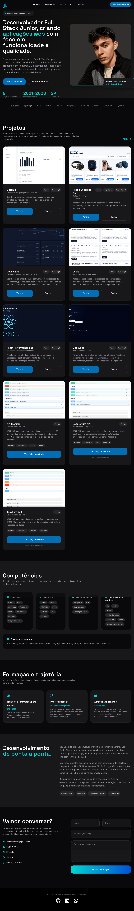

# 👋 Olá, eu sou Jean Ribeiro

### 💻 Desenvolvedor Full Stack Júnior

🇧🇷 Lorena, São Paulo, Brasil · 🎯 Em busca de oportunidades profissionais no Brasil

Sou Desenvolvedor Full Stack Júnior, com formação técnica em Computação para Internet e foco no desenvolvimento de aplicações web modernas e APIs REST.

Tenho uma base sólida em desenvolvimento frontend com **React, TypeScript e JavaScript**, além de experiência prática na criação de interfaces responsivas, componentes reutilizáveis e integração com APIs REST.

Também estou desenvolvendo minhas habilidades em backend com **Python, FastAPI e PostgreSQL**, por meio de projetos pessoais envolvendo desenvolvimento de APIs, autenticação, gerenciamento de dados e segurança.

---

## 🚀 Sobre Mim

- 💻 Foco em Desenvolvimento Full Stack e Web
- 🎓 Técnico em Computação para Internet
- 🇧🇷 Em busca de oportunidades profissionais no Brasil
- 🧩 Interesse em interfaces responsivas e intuitivas
- ⚛️ Experiência prática com React, TypeScript e JavaScript
- 🐍 Desenvolvendo projetos backend com Python e FastAPI
- 🗄️ Trabalhando com PostgreSQL e desenvolvimento de APIs REST
- 🔧 Desenvolvendo projetos pessoais para aprimorar minhas habilidades

---

## 🛠️ Tecnologias

### Frontend

### Backend

### Ferramentas

### 📚 Em Desenvolvimento

- SQLAlchemy e integração com bancos de dados em Python
- Arquitetura backend e desenvolvimento de APIs
- Testes automatizados e segurança de aplicações

**Ferramentas e práticas:** PostgreSQL · Docker · Docker Compose · Swagger UI · Pytest · Git

---

# 🌐 Meu Portfólio

### Conheça meus projetos

  

  <a href="https://jeanribeiro8.github.io/JeanRibeiro/">
    <strong>🌐 Acessar meu portfólio →</strong>
  </a>

  
  

---

# 🚀 Projetos em Destaque

## 🎓 TecSchool

**Tecnologias:** HTML · CSS · JavaScript · Bootstrap

Site responsivo para uma escola de tecnologia, desenvolvido com foco em design responsivo, organização de layouts e elementos interativos.

🌐 **Demonstração:**  
https://jeanribeiro8.github.io/TecSchool/

---

## 🔥 Blaze Agência

**Tecnologias:** HTML · CSS · JavaScript · Tailwind CSS

Site responsivo para uma agência de marketing, com interface moderna, apresentação de serviços, chamadas para ação e navegação adaptável.

🌐 **Demonstração:**  
https://blazeagencia.netlify.app/

---

## 🦷 BrightSmile

**Tecnologias:** HTML · CSS · JavaScript · Tailwind CSS

Site responsivo para uma clínica odontológica, com foco em interface moderna, apresentação de serviços, contato e chamadas para ação.

🌐 **Demonstração:**  
https://brightsmlle.netlify.app/

---

## 💼 Nexus Consulting

**Tecnologias:** HTML · CSS · JavaScript · Tailwind CSS

Site institucional responsivo desenvolvido para apresentar informações e serviços de uma empresa por meio de uma interface moderna.

🌐 **Demonstração:**  
https://nexusconsultin.netlify.app/

---

## 💼 Jobly — Plataforma de Busca de Empregos

**Tecnologias:** React · TypeScript · Vite · APIs REST

Aplicação frontend para pesquisar e visualizar oportunidades de emprego.

- Pesquisa, filtros e paginação.
- Integração com APIs REST e tratamento de estados de carregamento e erro.
- Componentes reutilizáveis e interfaces organizadas.

**Status:** Concluído · 2026

---

## 📊 API Monitor — Monitoramento de APIs

**Tecnologias:** Python · FastAPI · PostgreSQL · Docker · Docker Compose · Pytest

API REST para cadastrar e gerenciar serviços HTTP monitorados.

- Verificação de disponibilidade, status HTTP e tempo de resposta.
- Histórico de verificações e armazenamento de informações.
- Docker Compose para execução dos componentes da aplicação.
- Validação de endpoints por meio do Swagger UI e testes práticos.

**Status:** Em desenvolvimento · 2026

🌐 **Repositório:**  
https://github.com/JeanRibeiro8/api-monitor

---

## 🔐 SecureAuth API — Autenticação e Segurança

**Tecnologias:** Python · FastAPI · PostgreSQL · JWT · Argon2id

API REST voltada ao cadastro, autenticação e gerenciamento de usuários.

- Autenticação baseada em JWT e endpoints protegidos.
- Hash de senhas utilizando Argon2id.
- Gerenciamento de contas e validação de credenciais.

**Status:** Em desenvolvimento · 2026

---

## 📋 TaskFlow API — Gerenciamento de Tarefas

**Tecnologias:** Python · FastAPI · PostgreSQL · Pydantic

API REST para gerenciamento e organização de tarefas.

- Operações CRUD para gerenciamento de tarefas.
- Filtros por status e prioridade, pesquisa e paginação.
- Validação de dados e estruturação de endpoints.
- Documentação automática da API para testes dos endpoints.

**Status:** Em desenvolvimento · 2026

---

# 🎯 Objetivos Profissionais

Atualmente, estou em busca da minha primeira oportunidade profissional na área de desenvolvimento de software, com foco em **Desenvolvimento Full Stack**.

Meu objetivo é atuar em projetos reais, contribuir com equipes de desenvolvimento e continuar aprimorando minhas habilidades em tecnologias frontend e backend.

Tenho interesse em oportunidades no **mercado brasileiro**, especialmente em posições que envolvam **React, TypeScript, JavaScript, Python e FastAPI**.

---

# 🎓 Formação Acadêmica

### Técnico em Computação para Internet

**ETEC Padre Carlos Leôncio da Silva**

2021 – 2023

---

# 🌎 Idiomas

🇧🇷 **Português** — Nativo

🇺🇸 **Inglês** — A2+ (Básico)

Atualmente aprimorando minhas habilidades de comunicação em inglês, com foco em comunicação profissional e técnica.

---

# 🌎 Entre em Contato

📧 **E-mail:**  
jeanrsantos10@gmail.com

🌐 **Portfólio:**  
https://jeanribeiro8.github.io/JeanRibeiro/

---

  <i>Sempre aprendendo, desenvolvendo e evoluindo.</i>

